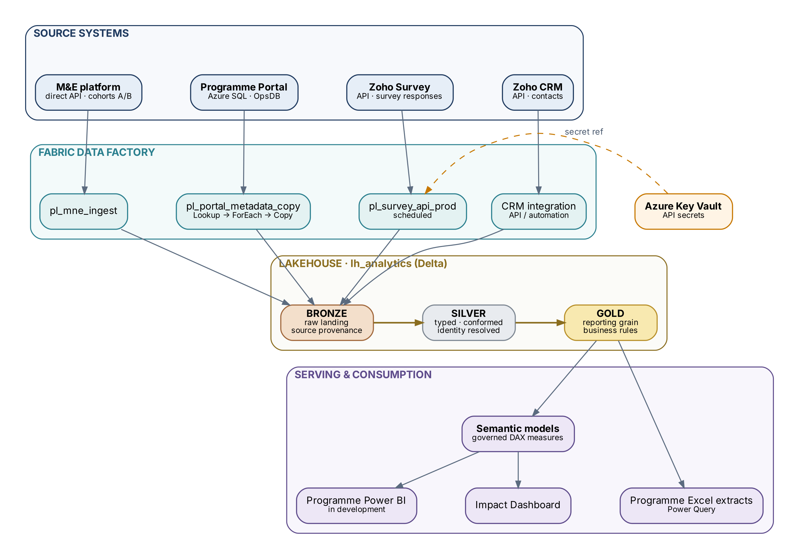
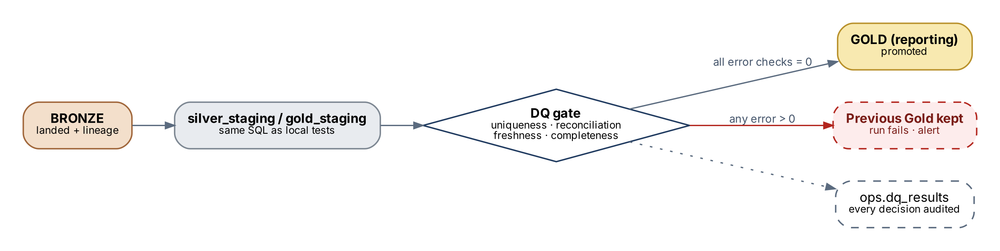

# Governed Medallion Lakehouse on Microsoft Fabric

**Taking four disconnected data feeds and turning them into one trusted source for programme reporting: reconciled, quality-gated and handed over to operations.**

[](https://github.com/TKMach/fabric-lakehouse-governance/actions/workflows/ci.yml)


> **Context.** This is a cleaned-up, runnable rebuild of a stabilisation programme I delivered as a Data Engineer at a South African SME-development organisation (Oct–Nov 2026). The architecture, design decisions and controls are real. **All data in this repo is synthetic**, and internal system, table and programme names have been replaced with generic ones.

---

## The problem

Programme reporting drew on four sources: an M&E platform API, an operational Azure SQL portal, a survey API and a CRM. Each one fed Excel and Power BI through its own logic. Typical symptoms:

- A cohort's **financials "went missing"** for two months. Everyone assumed the pipeline had lost data.
- **Two paths existed for the same metric**, and they gave different answers.
- **Missing reports showed up as zeros.** A business that never reported looked like one that reported zero jobs.
- Contacts were **counted per programme assignment** instead of per person.
- Survey ingestion depended on a **third-party webhook** with no replay.

## What I built



| Layer | Responsibility | Key rule |
|---|---|---|
| **Bronze** | Lands source data exactly as received | Nothing is changed; lineage columns are added (`_source`, `_run_id`, `_ingested_at`) |
| **Silver** | Types, conformance and identity | Period labels are parsed but kept; IDs resolve to `business_guid`; the latest revision wins; NULLs stay NULL |
| **Gold** | Business-ready data at reporting grain | One unique row per business × programme × month for **every eligible business**, with a submission status on each row |
| **Gate** | Data-quality checks before publishing | Gold is only promoted if every error-level check passes. Otherwise the previous Gold stays live |



## Engineering decisions worth reading

Each decision is written up as an ADR in [`docs/adr/`](docs/adr):

| ADR | Decision | Why it matters |
|---|---|---|
| [0001](docs/adr/0001-single-source-of-authority.md) | One authoritative source per reporting domain | Stops double counting when legacy and direct paths overlap |
| [0002](docs/adr/0002-pull-based-api-over-webhook.md) | Scheduled pull from the API + Key Vault, replacing the webhook | Reruns are deterministic, there are no third-party hops, and no secrets sit in code |
| [0003](docs/adr/0003-absent-is-not-zero.md) | **An absent record is not a zero** | Reported zeros, NULLs and non-submissions stay distinguishable all the way to the dashboard |
| [0004](docs/adr/0004-metadata-driven-ingestion.md) | Metadata-driven Lookup → ForEach → Copy | Adding a source table means adding a config row, not changing the pipeline |
| [0005](docs/adr/0005-portable-sql-tested-locally.md) | Transforms written as portable SQL, tested locally in DuckDB | The same SQL that CI tests is what runs on Fabric Spark |

## Outcomes (from the real engagement)

- **100% record-level reconciliation** from Bronze to Gold for the reference month across two cohorts. Financial values matched exactly (NULL-safe). Every jobs difference was classified, and all of them turned out to be NULL → 0 conversions rather than changed values.
- **Root-caused the "missing months" incident.** The source view had incomplete coverage; the pipeline had not lost anything. I proved this by comparing a source preview against the landed table, and moved the affected cohorts to the direct API path.
- **Headline Power BI KPIs** (turnover, expenses, net income, jobs) **matched Gold** at display precision.
- **Zero duplicate contacts** after match-and-merge. Contact grain and programme-assignment grain are now modelled separately.
- **The survey pipeline was moved to production.** It now uses a scheduled API pull, secrets in Azure Key Vault and full medallion processing, replacing the webhook proof of concept.
- **Handed over to operations** with 9 SOPs, an evidence index, a risk register and a formal acceptance pack.

## Run it locally (about 30 seconds, no cloud needed)

```bash
pip install -r requirements.txt
make data      # generate a deterministic synthetic dataset (110 businesses, 2 cohorts, 4 months)
make demo      # build Silver + Gold in DuckDB, run the DQ gate, print the KPI table
make test      # 23 unit + end-to-end tests
```

```
DATA QUALITY GATE
[PASS] uniqueness   gold_financials_grain_unique             violations=0
[PASS] uniqueness   gold_jobs_grain_unique                   violations=0
[PASS] consistency  recon_financials_bronze_to_gold          violations=0
[PASS] consistency  recon_jobs_no_value_changed              violations=0
[WARN] completeness unmatched_source_records                 violations=1
[PASS] freshness    freshness_latest_period                  violations=0
[PASS] completeness eligible_population_not_empty            violations=0

GOLD KPI SUMMARY
programme  period  eligible  submitted  partial  all_null  missing    turnover  jobs  jobs_complete
COHORT_A   202609        54         48        1         3        2  24,113,800  3763             47
...
GATE PASSED: Gold is publishable.
```

The synthetic generator deliberately injects the failure modes found in production: non-submitters, all-NULL submissions, partial jobs, resubmissions, an unmapped project and mid-window exits. The tests then check that each one is handled correctly. Two of the tests **corrupt Gold on purpose** to prove the gate catches it.

## Repository layout

```
sql/
  silver/   01_financials.sql  02_jobs.sql  03_eligibility.sql      <- plain SELECTs, Spark SQL + DuckDB compatible
  gold/     01_fact_financials_monthly.sql  02_fact_jobs_monthly.sql  03_kpi_programme_month.sql
  dq/       7 checks; each returns violating rows, with severity in a header comment
src/lakehouse_gov/
  runner.py      local DuckDB runner: materialises layers, runs the gate, exits non-zero on failure
  periods.py     "Y14 M9" -> 2026-09 period parsing (the cause of a real "no September data" false alarm)
  exceptions.py  reference classification: SUBMITTED / PARTIAL / ALL_NULL / MISSING / NOT_REQUIRED
fabric/
  notebooks/nb_bronze_api_ingest.py       paginated REST -> Bronze, Key Vault secrets, idempotent MERGE
  notebooks/nb_transform_silver_gold.py   runs sql/ on Fabric: build to staging -> DQ gate -> promote
  pipelines/pl_portal_metadata_copy.json  Lookup -> ForEach -> Copy -> run log -> transform+gate
scripts/generate_synthetic_data.py         deterministic data with injected failure modes + manifest
tests/                                     unit, end-to-end and "gate must bite" tests
docs/                                      architecture, ADRs, data contracts, DQ framework, runbook
```

## Documentation

- [Architecture](docs/architecture.md): all pipelines with diagrams, the identity model and the object inventory
- [Data contracts](docs/data-contracts.md): grain, identity, periods, revisions, NULL semantics and consent
- [Data quality framework](docs/data-quality.md): six dimensions and how the gate enforces them
- [Operations runbook](docs/runbook.md): run triage flow plus SOP-01 to SOP-09

## Stack

Microsoft Fabric (Data Factory pipelines, Lakehouse, Spark notebooks) · Delta Lake · Azure SQL · Azure Key Vault · Power BI (DAX, semantic models) · Zoho Survey / CRM APIs · PySpark · SQL · DuckDB · pytest · GitHub Actions

---

*Takudzwa Machaya · Data Engineer · Cape Town*
