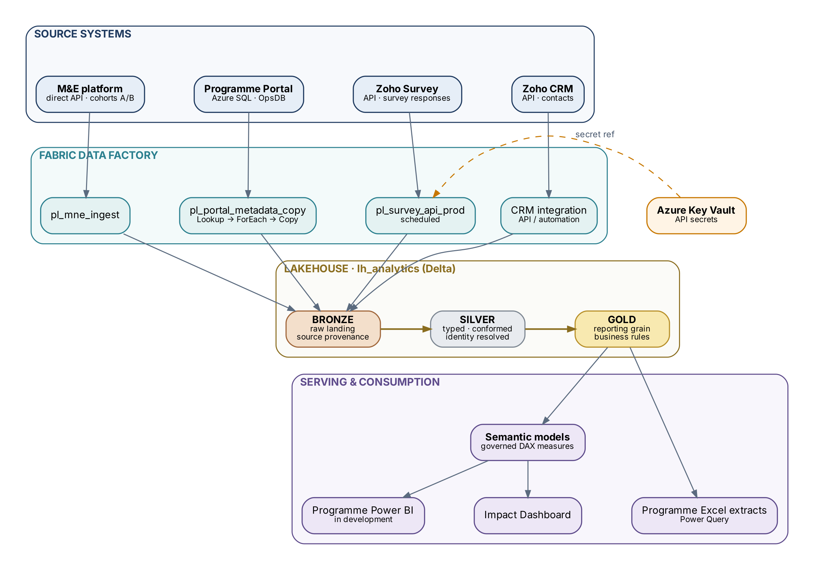
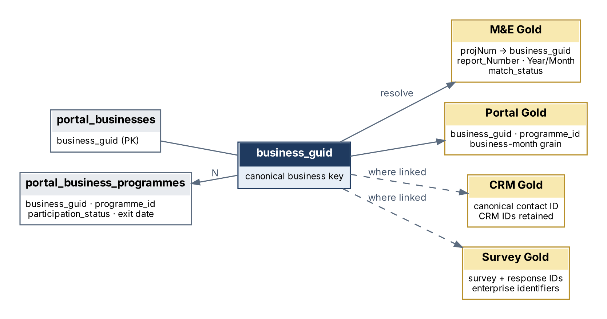
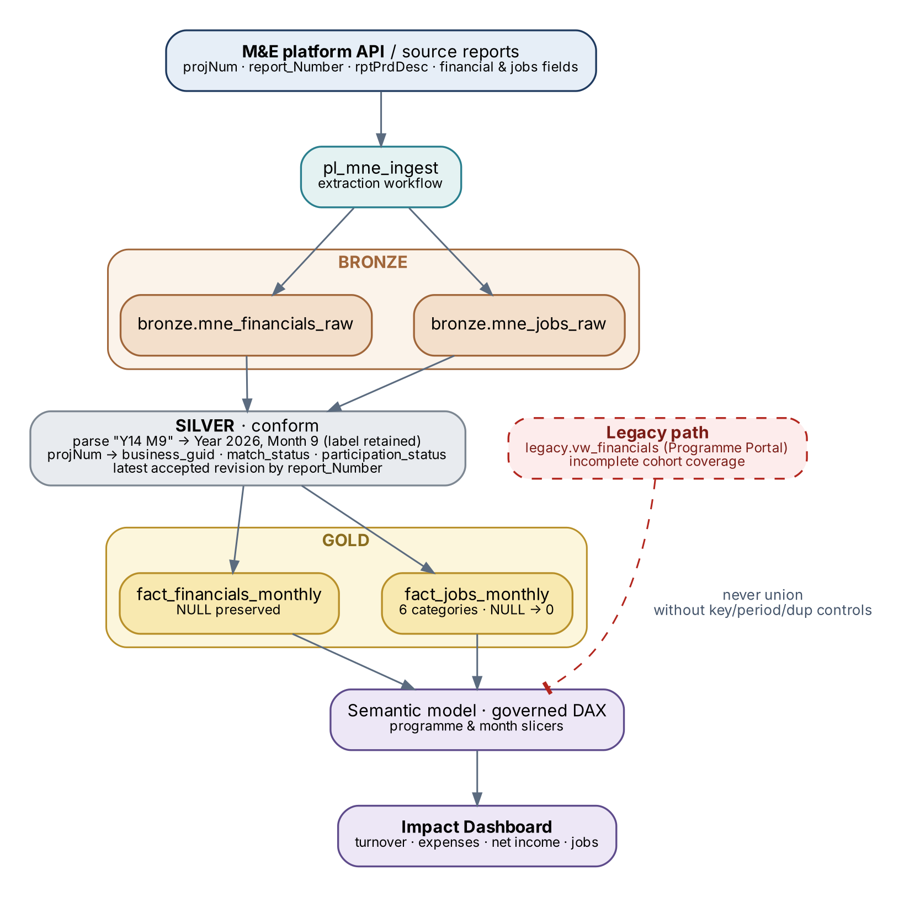
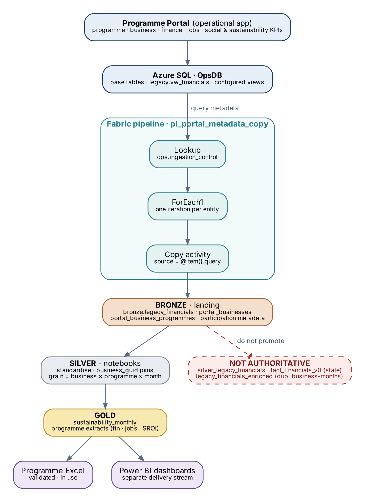
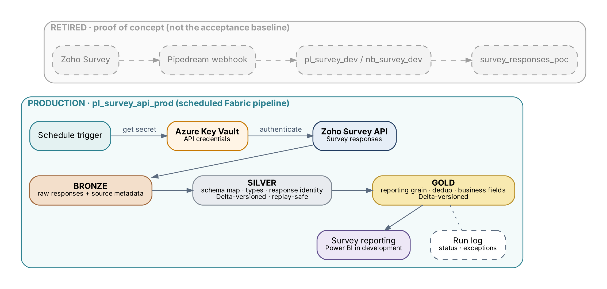
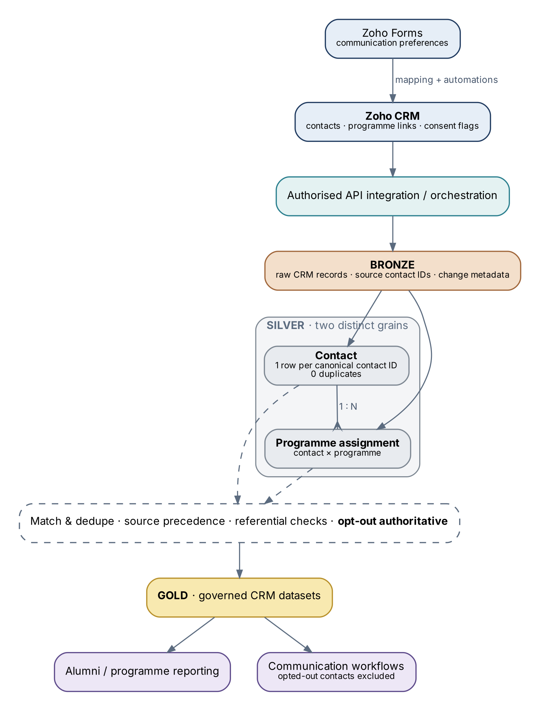
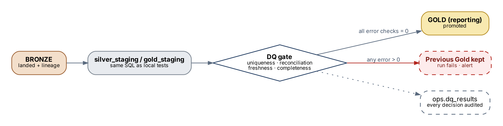

# Architecture

- [Reference architecture](#reference-architecture)
- [Medallion layer contract](#medallion-layer-contract)
- [Source of authority](#source-of-authority)
- [Conformed identity](#conformed-identity)
- [Pipelines](#pipelines)
- [Object inventory](#object-inventory)

## Reference architecture

All four source domains land in one Fabric Lakehouse (`lh_analytics`, Delta) and move up through Bronze → Silver → Gold. **Reports only ever read from Gold**, through governed semantic models (Power BI) or validated Power Query extracts (Excel). API credentials are held in Azure Key Vault.

## Medallion layer contract

| Layer | Responsibility | Contract (must hold) |
|---|---|---|
| Bronze | Faithful landing | Source columns and values are unchanged. Source IDs, period labels and lineage (`_source`, `_run_id`, `_ingested_at`) are kept. History is never overwritten without a way to recover it |
| Silver | Typed, validated, conformed | Schema and types are enforced. Period labels are mapped to Year/Month with the original label kept. Identity resolves to `business_guid` or a canonical contact ID. Revisions are resolved (latest accepted wins) |
| Gold | Reporting grain | The grain is declared and unique. Business rules are applied once. NULL vs zero semantics are explicit ([ADR 0003](adr/0003-absent-is-not-zero.md)). This is the only layer reports consume |
| Serving | Measures and extracts | DAX and Power Query reference Gold only. Relationship and filter direction are reviewed in the model, not patched inside measures |

## Source of authority

| Domain | Authoritative source | Notes |
|---|---|---|
| Active cohorts: financials and jobs | M&E platform API | The legacy portal view is **not** authoritative for these cohorts ([ADR 0001](adr/0001-single-source-of-authority.md)) |
| Historical cohorts and other programmes | Operational portal (Azure SQL) | Metadata-driven ingestion |
| Survey programme | Survey API | Scheduled pull ([ADR 0002](adr/0002-pull-based-api-over-webhook.md)) |
| Contacts and programme assignments | CRM | Contact and assignment grains are kept separate |

## Conformed identity

`business_guid` is the canonical business key. Source keys (the M&E `proj_num`, portal IDs, CRM IDs) are always kept next to it, so any Gold row can be traced back to the record that produced it. A submission whose source key can't be resolved is marked `UNMATCHED` in Silver and raises a warning in the gate. It is never silently dropped.

## Pipelines

### M&E platform (active cohorts)

- Period labels look like `Y14 M9` (programme-relative). A calendar-text search returned "no September records", which was a false alarm. The parser ([`periods.py`](../src/lakehouse_gov/periods.py)) maps the label to Year/Month using an anchor year that was validated against a reference period.
- The revision key is `proj_num + report_number`; the latest accepted revision wins.
- **Net income is carried as the source-reported value.** It is not recomputed from turnover − expenses, because the source includes other income.

### Operational portal (metadata-driven)

Lookup on `ops.ingestion_control` → ForEach → Copy `@item().source_query` → run log → transform + gate. See [ADR 0004](adr/0004-metadata-driven-ingestion.md). Tables on the legacy path that were stale or had duplicated business-months are quarantined as **not authoritative**.

### Survey API (production)

The retired webhook proof of concept is shown greyed out for context. Production uses a scheduled pull with Key Vault and an idempotent MERGE on `response_id`.

### CRM

**Contact** grain (one row per canonical contact) and **assignment** grain (contact × programme) are separate tables. Counting assignment rows as people was one of the original reporting errors. Unsubscribe and opt-out settings are authoritative regardless of programme membership.

### Publish gate

## Object inventory

| Object | Type | Layer | Disposition |
|---|---|---|---|
| `pl_mne_ingest`, `pl_portal_metadata_copy`, `pl_survey_api_prod` | Pipelines | Orchestration | Authoritative |
| `pl_survey_dev` / `nb_survey_dev` | Pipeline / notebook | Orchestration | Retired |
| `ops.ingestion_control`, `ops.run_log`, `ops.dq_results` | Control / audit | Ops | Supporting |
| `bronze.mne_financials_raw`, `bronze.mne_jobs_raw` | Delta | Bronze | Authoritative |
| `bronze.portal_businesses`, `bronze.portal_business_programmes` | Delta | Bronze | Authoritative |
| `bronze.legacy_financials` | Delta | Bronze | Supporting (historical cohorts only) |
| `silver_legacy_financials`, `fact_financials_v0`, `legacy_financials_enriched` | Delta | Silver / Gold | **Not authoritative**, scheduled for decommission |
| `silver.financials`, `silver.jobs`, `silver.eligibility` | Delta | Silver | Authoritative |
| `gold.fact_financials_monthly`, `gold.fact_jobs_monthly`, `gold.kpi_programme_month` | Delta | Gold | Authoritative |
