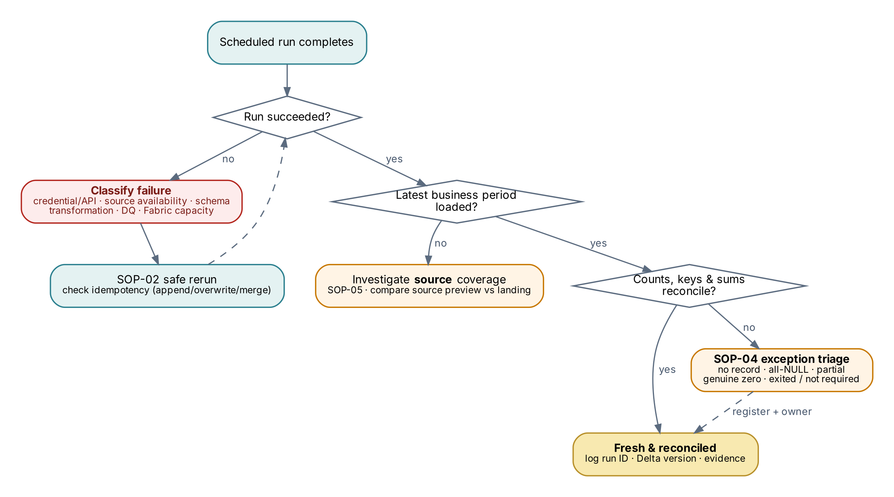

# Operations runbook

## Run triage

**A green pipeline run doesn't mean the data is fresh.** Data counts as fresh only once the latest business period has landed **and** reconciles.

## Standard operating procedures

### SOP-01 Scheduled pipeline health review
1. Check the latest run of each critical pipeline against its schedule.
2. Record the pipeline, run ID, start and end times, status, source period and target update time.
3. Look at failed or skipped activities, notebook exit payloads and `ops.dq_results`.
4. Classify any failure as credential/API, source availability, schema, transformation, data quality or capacity, then escalate to the owner.
5. Confirm the latest **business period** has landed, not just that the run succeeded.

### SOP-02 Safe rerun and recovery
1. Before rerunning, confirm the write mode (append, overwrite or merge) and whether the run is idempotent.
2. Capture the failed run ID, period and error, and check for partial writes.
3. Rerun only the failed window or activity.
4. Afterwards, verify counts, keys, reconciled sums and the Delta version, then log the resolution.

### SOP-03 Monthly source-to-Gold reconciliation
1. Apply the source-of-authority matrix.
2. Fix the period and the eligible population, including exits.
3. Compare record counts, distinct IDs, financial values, the six jobs categories and NULL counts.
4. Join on **source key + period + revision**, never on business name.
5. Compare semantic-model and Excel outputs at the correct filter context.

### SOP-04 Missing-report and NULL triage
1. Classify each case as MISSING, ALL_NULL, PARTIAL, genuine zero or NOT_REQUIRED.
2. Check the raw source before calling a Gold gap a pipeline failure.
3. Ask the programme owner to confirm submission status and exit dates.
4. Track each item in the exception register with its owner and resolution date.

### SOP-05 Operational-database source discrepancy
1. Preview the source query and compare it with the Bronze counts.
2. If they agree but data is missing, investigate **source coverage**, not the Copy activity.
3. Never save preview-only SQL edits into `ops.ingestion_control`.
4. Validate any revised query outside production, then reconcile before promoting it.

### SOP-06 Period and revision validation
1. Inspect the raw period-label format before filtering on it.
2. Map labels to Year/Month, keep the original label, and compare on `proj_num + report_number`.
3. Quantify NULL → 0 conversions separately from value changes.

### SOP-07 API and credential monitoring
1. Review scheduled API runs, authentication results and Key Vault access.
2. Check response IDs, layer volumes, field count and schema drift.
3. Rerun failed windows using the stable natural key. Snapshot counts are evidence, not thresholds.

### SOP-08 CRM integrity and opt-out
1. Check that canonical contact IDs and assignment keys are unique.
2. Confirm that merges neither create duplicates nor erase legacy attributes.
3. Confirm that campaigns exclude opted-out contacts.
4. Restrict and audit personal-data exports.

### SOP-09 Change control and evidence
1. Record each change request: reason, affected objects, downstream impact, owner and rollback plan.
2. Before promotion, run the DQ gate and spot-check representative KPIs.
3. Keep the pipeline and notebook version, run ID, Delta version and validation output.
4. Changes to identifiers, eligibility, access or financial measures need owner approval.
